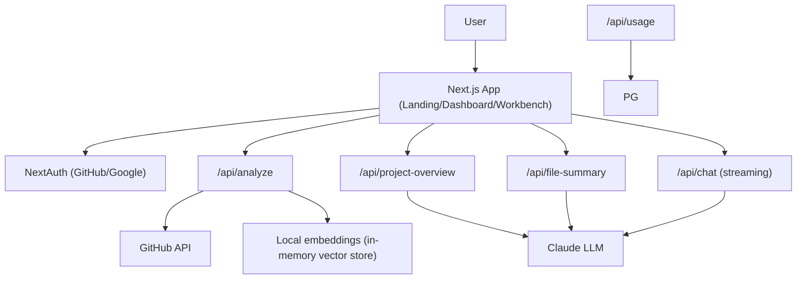

<p align="center">
  
</p>

# gitlore

AI-assisted repository narrator built with Next.js App Router and Claude. Paste a GitHub URL and gitlore delivers repo-level overviews, hotspots, file-by-file summaries, and Mermaid diagrams, plus a RAG-backed chat tied to the file you are viewing.

## What the app does
- Analyzes GitHub repos with Claude: elevator pitch, stack radar, hotspots, file summaries, and diagrams.
- Surfaces: landing (`HeroLanding`), dashboard (`CockpitDashboard` + `ProjectOverview`), and workbench (`DeepDiveExplorer`) with code viewer + per-file explanations and diagrams. `OmniChat` provides contextual Q&A.
- Enforces per-user usage metering (tokens + request counts) with UI display (`UsageIndicator`/`UsageModal`).

## Example architecture diagram (Mermaid)


## Architecture (high level)
- **Frontend:** Next.js 16 (App Router), React 19, TypeScript, framer-motion, lucide-react, recharts (radar), reactflow, Monaco editor, Mermaid renderer, react-resizable-panels, ReactMarkdown. Styling via utility classes in `globals.css`.
- **Access:** No accounts. Visitors are metered by a hashed IP address, with a site-wide daily token budget on top.
- **Backend APIs:** Next.js route handlers (see below) orchestrate GitHub fetches, Claude calls, caching, and token accounting.
- **Data:** No database. Usage counters, summaries, overviews and the vector store are held in server memory and reset when the server restarts.

## Key flows & API routes
- `POST /api/analyze` — Validate GitHub URL, fetch repo metadata/README, fetch a subset of files, build hotspots, embed code snippets, and ask Claude for elevator pitch + stack radar. Returns `repoId`, sample/full file tree, hotspots, and sample code.
- `POST /api/project-overview` — Given owner/name/tree/sampleCode, prompts Claude for overview, architecture, key components, data flow, tech stack, dependencies, and two Mermaid diagrams. Cached in memory.
- `POST /api/file-summary` — Fetches a raw file from GitHub, truncates, and prompts Claude for markdown summary + Mermaid diagram.
- `POST /api/chat` — Streams Claude responses; can include RAG context from the in-memory vector store and the current file content.
- `POST /api/index-repo` — Stubbed placeholder; returns a queued `jobId`.
- `GET /api/usage` — Returns the caller's token/request usage for the day.
- `POST /api/mcp/<key>` — MCP server for AI coding agents (see below). `POST /api/mcp-key` issues keys.

## MCP server
`/api/mcp` lets AI coding agents (Claude Code, Cursor, any Streamable HTTP MCP client) run gitlore's code review checks before they commit. The checks are the same ones the VS Code extension uses (`src/lib/codeReview.ts`).

| Tool | Input | Returns |
|---|---|---|
| `score_risk` | `code` (≤5,000 chars) | `score` 1-10 and a one-line `reason` |
| `check_impact` | `code` (≤5,000 chars) | `riskLabel`, `summary`, `touches` (PII / Auth / External API / Database write), `complexity` 0-100 |
| `explain_file` | `content`, optional `path` | `purpose`, `components`, `architecture`, `truncated` |

The server tells agents to flag a risk score of 7+ or any change touching PII, Auth or Database write to the user before committing.

**Access:** every call needs a personal key. Visitors get one free, without signing up, from the "MCP server" section of the home page (`/#mcp`), which calls `POST /api/mcp-key` (capped at 5 keys per visitor per day). Keys are signed with `MCP_SIGNING_SECRET`, so nothing is stored; changing that secret revokes every key. Usage is metered per key, because connector traffic such as claude.ai's arrives from the platform's IPs, and the site-wide daily budget still applies on top.

The key goes in the URL, `https://gitlore.app/api/mcp/<key>`, so it works anywhere that accepts a server URL, including Claude's custom connectors. Clients that can send headers can use `https://gitlore.app/api/mcp` with `Authorization: Bearer <key>` instead.

**Claude (web or desktop):** Settings → Connectors → Add custom connector, then paste the link.

**Claude Code:**
```bash
claude mcp add --transport http gitlore https://gitlore.app/api/mcp/<key>
```

**Cursor** (`~/.cursor/mcp.json`):
```json
{ "mcpServers": { "gitlore": { "url": "https://gitlore.app/api/mcp/<key>" } } }
```

## Frontend experience
- **Dashboard:** Radar chart for stack balance, hotspots list, and project overview with diagrams (`ProjectOverview`).
- **Workbench:** File tree from returned file list; selecting a file calls `/api/file-summary`, caches client-side, shows read-only Monaco code, markdown summary, and Mermaid diagram; fullscreen toggles supported.
- **Chat:** Floating chat with optional file context and RAG results from embeddings.

## Tech stack & dependencies
- Next.js 16 (App Router), React 19, TypeScript.
- Claude API (`@anthropic-ai/sdk`) for chat/summarization; embeddings are a local hashed bag-of-words.
- recharts, mermaid, reactflow, framer-motion, lucide-react, Monaco editor, ReactMarkdown, react-resizable-panels.

## Environment & config
Required for core features:
- `ANTHROPIC_API_KEY` — Claude API key.
- `ANTHROPIC_MODEL` — Optional; defaults to `claude-haiku-5-5`.
- `GITHUB_PAT` — Optional; raises GitHub rate limits.
- `USAGE_SALT` — Random string mixed into the IP hash used for usage metering.
- `GLOBAL_DAILY_TOKEN_LIMIT` — Optional; site-wide daily token budget, defaults to 2,000,000.
- `EXTENSION_SECRET` — Shared key the VS Code extension sends to `/api/extension/*`.
- `MCP_SIGNING_SECRET` — 32+ random characters used to sign MCP keys. The MCP server and key endpoint stay off until it's set.
- Optional vector store placeholders: `VECTOR_DB_URL`, `VECTOR_DB_KEY`, `VECTOR_DB_PROVIDER`.

Rate limits (enforced in `tokenUsage.ts`):
- 50k tokens/day, 100 requests/day, 10 requests per 60s window per user.

## Running locally
1) Install deps: `npm install`  
2) Copy `.env.local.example` (create if missing) to `.env.local` and fill required keys.  
3) Run dev server: `npm run dev`  
4) Open http://localhost:3000.

## Repository layout (not exhaustive)
- `src/app` — App Router pages and API routes (`api/analyze`, `api/project-overview`, `api/file-summary`, `api/chat`, `api/usage`, auth).
- `src/components` — UI: landing, dashboard, workbench, chat, diagrams, auth, layout.
- `src/context` — `RepoContext`, `FileContext`.
- `src/lib` — Adapters for Claude, GitHub, embeddings, token usage, diagram cache/store, vector store.
- `__tests__/landing.test.tsx` — Basic landing test (needs more coverage).

## Notable gaps / TODOs
- README was previously placeholder; broader docs welcome (deployment, security notes, UI screenshots).
- `/api/index-repo` is stubbed; background indexing pipeline not implemented.
- No external vector DB integration—embeddings live in-memory.
- Test coverage limited to landing page.

